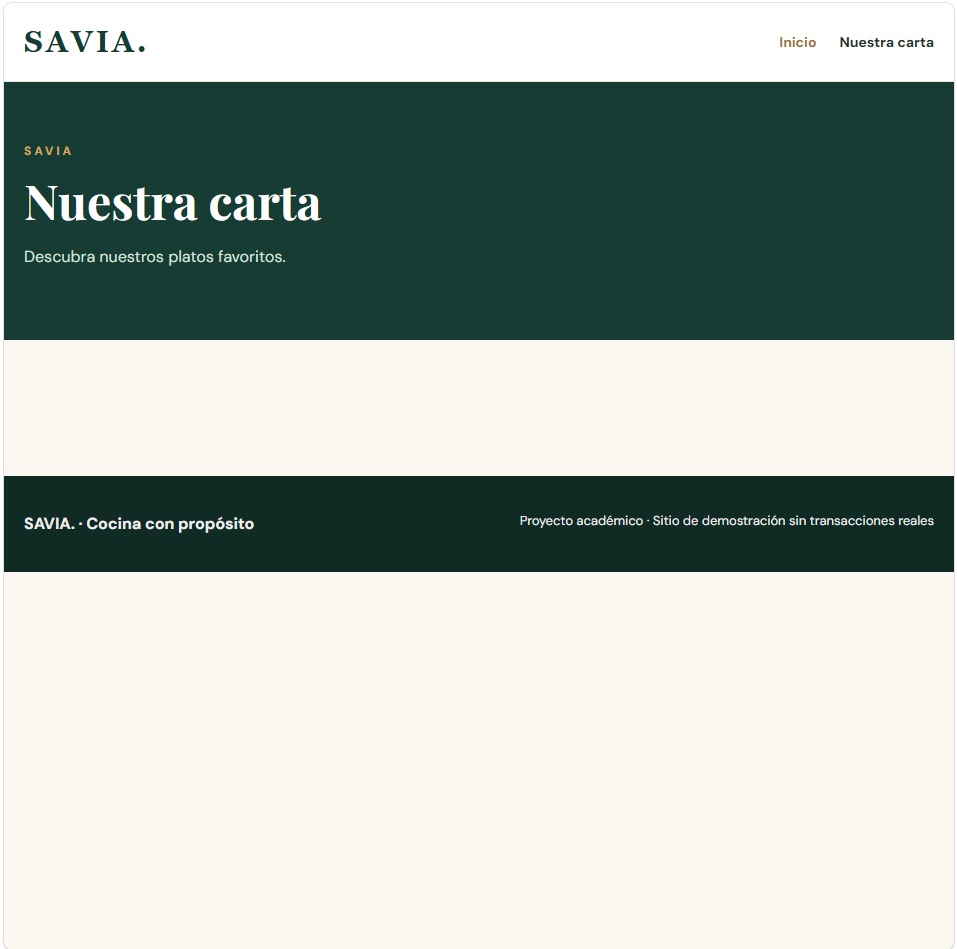
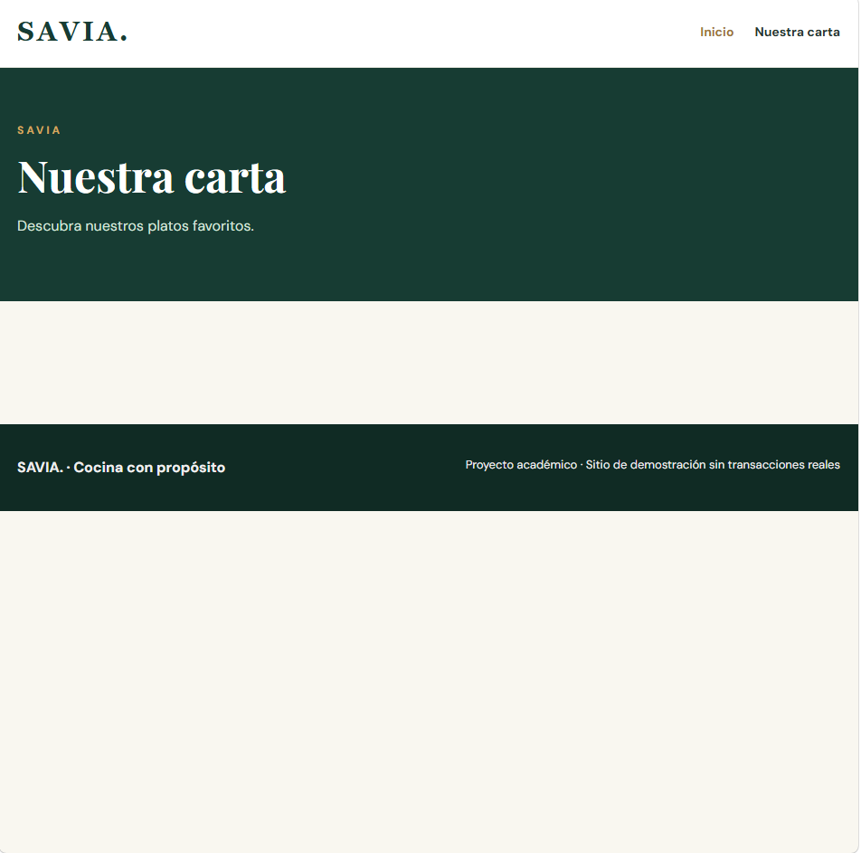

# SAVIA — examen N.º 1

Proyecto estático HTML + CSS. Abrir `index.html` en el navegador. No necesita dependencias.

El sitio incluye la página Inicio y las plantillas `pages/menu.html`, `pages/equipo.html` y `pages/eventos.html` con contenido central pendiente. Siga exclusivamente las especificaciones del examen para conocer el comportamiento esperado. No modifique el tema general ni sustituya el proyecto por otro.

## Diagnóstico de cinco incidencias

| N.º | Comportamiento observado | Causa técnica y ubicación | Corrección realizada | Prueba de verificación | Autor |
|---|---|---|---|---|---|
| 1 | | | | | |
| 2 |Se redirige a una pagina incorrecta y no se cuenta con nav | index.html/linea 15, se usa href="./pages/eventos.html"| Corregir ruta a la pagina correcta en pages/menu.html||Esteban Torres Jimenez|
| 3 |El boton no redirige a ninguna pagina |index.html/linea30 se usa href="#" |Especificar ruta a pages/menu.html| | Esteban Torres Jimenez|
| 4 | | | | | |
| 5 | | | | | |

## Responsables de las funcionalidades

| Estudiante | Página asignada | Rama | Commits principales |
|---|---|---|---|
| | | | |

## Evidencias Git

| Funcionalidad/corrección | PR hacia develop | Revisor | Resultado de merge / conflicto si ocurrió |
|---|---|---|---|
| | | | |

## Verificación final
Registrar las pruebas de funcionamiento a 1280 px y 375 px, enlaces y páginas.
