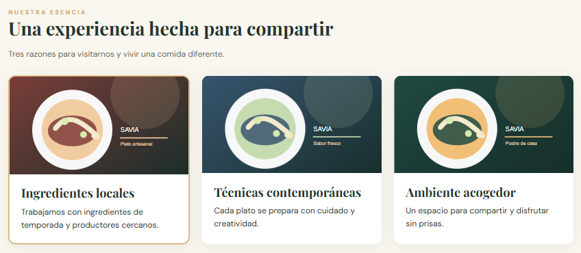
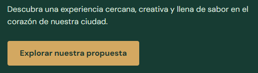
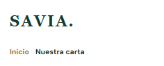

# SAVIA — examen N.º 1

Proyecto estático HTML + CSS. Abrir `index.html` en el navegador. No necesita dependencias.

El sitio incluye la página Inicio y las plantillas `pages/menu.html`, `pages/equipo.html` y `pages/eventos.html` con contenido central pendiente. Siga exclusivamente las especificaciones del examen para conocer el comportamiento esperado. No modifique el tema general ni sustituya el proyecto por otro.

## Diagnóstico de cinco incidencias

| N.º | Comportamiento observado                                       | Causa técnica y ubicación                | Corrección realizada                    | Prueba de verificación                                             | Autor          |
| --- | -------------------------------------------------------------- | ---------------------------------------- | --------------------------------------- | ------------------------------------------------------------------ | -------------- |
| 1   | Las cartas se alinean en formato lista (una debajo de la otra) | styles.css:125: flex-direction: column.  | Se elimina styles.css:125.              |    | Dilan Rojas    |
| 2   | Enlace a Nuestra carta no redirige a la pagina correcta        | index.htm:15:href="pages/eventos.html">  | Corregir href="pages/menu.html"         |   | Esteban Torres |
| 3   | Boton no redirige a ningun lado                                | index.htm:30:href="#">                   | Corregir href="pages/menu.html"         |  | Esteban Torres |
| 4   | Botón del hero tiene un fondo rojo                             | styles.css:244: background: #bd4d58      | styles.css:244: background: var(--gold) |    | Dilan Rojas    |
| 5   | Enlaces del nav se colapsan a > 375px                          | styles.css:41: no existe flex-wrap: wrap | styles.css:45: flex-wrap: wrap          |    | Dilan Rojas    |

## Responsables de las funcionalidades

| Estudiante     | Página asignada        | Rama   | Commits principales                                              |
| -------------- | ---------------------- | ------ | ---------------------------------------------------------------- |
| Esteban Torres | Página: Nuestro Equipo | ramaf2 | feat: Se actualiza el navbar de cada pagina, feat: pagina equipo |

## Evidencias Git

| Funcionalidad/corrección | PR hacia develop | Revisor | Resultado de merge / conflicto si ocurrió |
| ------------------------ | ---------------- | ------- | ----------------------------------------- |
|    Bugs                  |  Bugs#1          | Dilan Rojas  |  No ocurrieron conflictos            |
|    Feature 1: Pagina Menu             |  Feature 1       | Esteban Torres  |  No ocurrieron conflictos           |
|    Feature 2: Pagina Nuestro Equipo             |  Feature 2       | Esteban Torres  |  Conflictos en el menu.html resueltos           |

## Verificación final

Registrar las pruebas de funcionamiento a 1280 px y 375 px, enlaces y páginas.
